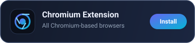

# 🚀 Push It

Send links, notes, photos, and files privately between **any phone and any computer** — end-to-end encrypted, instant, and hosted 100% on **Cloudflare Workers**.

No accounts. No Google/Firebase dependencies. Works across Windows, macOS, Linux, Android, and iOS/iPadOS.

---

## 🧩 Browser Extensions

Click your browser below to download the ready-to-add extension package:

  
  &nbsp;
  

- **Chrome / Edge / Brave / Arc / Vivaldi:** Unzip `push-it-chromium.zip` → open `chrome://extensions` → enable **Developer mode** → **Load unpacked**.
- **Firefox / Zen / Floorp / LibreWolf:** Open `about:debugging#/runtime/this-firefox` → **Load Temporary Add-on** → select `push-it-firefox.xpi` (or sign via Mozilla AMO for permanent 1-click installs).

*(Or build both locally anytime with `bun run build:extensions`.)*

---

## 📱 Usage Flow

### 1. Start Your Private Room
1. Open your deployed Push It URL on your first device.
2. Name your device (e.g., `iPhone`, `Pixel`, or `Work PC`).
3. *(Optional)* Toggle **Protect room with a 6-digit PIN** if you want an extra code required whenever pairing future devices.
4. Click **Create New Room**.

### 2. Pair More Devices (6-Digit Code or QR)
1. On an already-paired device, open **Settings → + Add Device** (or **+ Invite** in the extension).
2. You'll get a **single-use 6-digit pairing code** (e.g., `482 – 917`), a **QR code**, and a **shareable link** — valid for **5 minutes**.
3. On the new device, either:
   - **Type the 6 digits** directly into Push It (PWA or browser extension), **or**
   - **Scan the QR code** with your phone camera.
4. If your room has a **6-digit Room PIN**, enter it to finish. The pairing code immediately expires after joining.

### 3. Share Instantly Anywhere
- **From Android:** Install Push It as a PWA, then tap **Share → Push It** from any app.
  - **1 other device:** Pushes right away and shows a confirmation **Toast** (`✓ Sent to ...`) before returning to your app.
  - **Multiple devices:** Prompts you to choose a specific device or **All Devices (Room)**, then shows the confirmation **Toast**.
- **From iPhone / iPad:** Tap Safari's **Share → Add to Home Screen** to enable notifications, and follow the 2-step **iOS Share Sheet Shortcut** card in Settings for the exact same Share Sheet picker + toast.
- **From Desktop:** Click **Push This Tab**, paste text/screenshots (`Ctrl+V`), attach files up to **7.5 MB**, or right-click any page/link → **Push It → Device**. Incoming links auto-open in a new tab.

---

## 🔐 Security

Push It is designed so **only devices you explicitly pair together** can ever access your room — knowing the URL or room ID alone cannot read, send, list, or remove anything.

- **End-to-End Encryption (AES-GCM 256-bit):** Every message, device name, note, and file is encrypted in your browser before leaving the device. Ciphertext is bound to its `roomId`, `messageId`, and `senderId` using **AAD** to prevent tampering or replay.
- **Per-Device Credentials:** Each paired device gets its own random 256-bit Bearer token (stored on Cloudflare only as a SHA-256 hash). Every API endpoint verifies the token and enforces the sender identity server-side. WebSockets use single-use 30-second tickets.
- **Single-Use 5-Minute Pairing:** Rooms lock after creation. New devices can only join with a single-use 5-minute invite or 6-digit pairing code (where the room key is PBKDF2-encrypted and strictly rate-limited to 5 attempts per IP before blocking).
- **Optional 6-Digit Room PIN:** Enable in Setup or Settings to require a second 6-digit code whenever any new device tries to join—even if someone grabs your QR code or link.
- **Instant Revocation:** Removing a device in Settings deletes its token and disconnects its WebSocket immediately. It cannot reconnect unless you explicitly invite it again.
- **Optional Server Access Code (`ACCESS_KEY`):** Set `ACCESS_KEY` in Cloudflare Worker secrets (e.g., a 6-digit code via `bunx wrangler secret put ACCESS_KEY`) so strangers who find your URL cannot create rooms on your Worker.
- **Auto-Deleting Storage:** Online messages never touch disk. Offline messages and encrypted blobs delete automatically the moment every recipient receives them (or after 28 days max).

---

## 🌐 Works Everywhere

| Platform | PWA & Live Sync | Offline Notifications | Share Sheet | Browser Extension |
| --- | --- | --- | --- | --- |
| **Android** (Chrome, Edge, Brave, Samsung) | ✅ | ✅ Web Push | ✅ Native picker + toast | — |
| **iOS / iPadOS** (Safari 16.4+) | ✅ Home Screen | ✅ Web Push | ✅ 2-step Apple Shortcut | — |
| **Windows / macOS / Linux** (Chromium) | ✅ | ✅ Web Push / Ext | ✅ Right-click & Tab push | ✅ `push-it-chromium.zip` |
| **Windows / macOS / Linux** (Firefox 121+) | ✅ | ✅ Web Push / Ext | ✅ Right-click & Tab push | ✅ `push-it-firefox.xpi` |
| **macOS** (Safari) | ✅ Dock Web App | ✅ Web Push | Copy / Paste | — |

---

## ☁️ Self-Host on Cloudflare Workers

1. Go to **Cloudflare Dashboard → Workers & Pages → Create → Import a repository** and select this repo.
2. Set **Build command:** `bun install && bun run build` and **Deploy command:** `bunx wrangler deploy`.
3. *(Optional, recommended)* Add a Worker secret named `ACCESS_KEY` (any numeric code like `482917`) so only you can create new rooms on your instance.
4. Click **Save and Deploy**.
